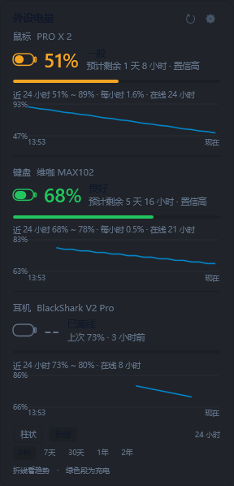
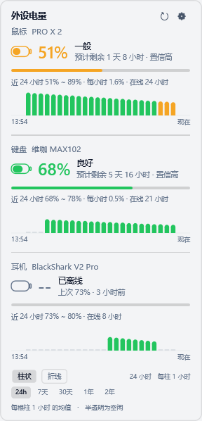
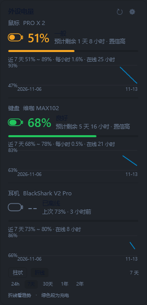
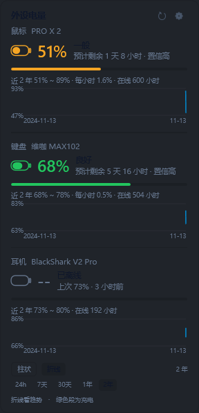
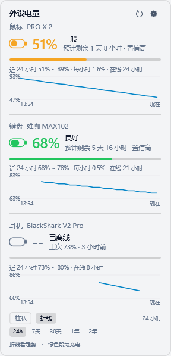
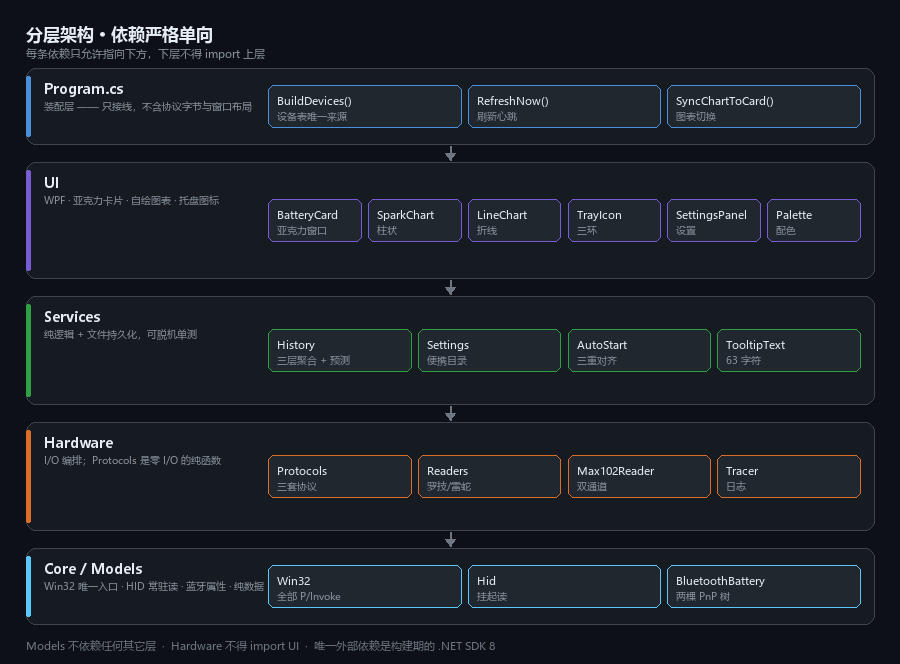
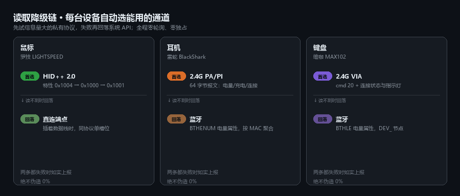

<div align="center">

# 外设电量 · Peripheral Battery

**一个托盘图标，盯住三台无线外设的电量。**<br>
罗技 LIGHTSPEED 鼠标 · 雷蛇耳机 · 维咖 MAX102 键盘 —— 2.4G 与蓝牙双通道自动切换。

[](#构建)
[](#构建)
[](#设计约束)
[](#性能)
[](#测试)



</div>

---

## 目录

- [它解决什么问题](#它解决什么问题)
- [功能](#功能)
- [界面](#界面)
- [架构](#架构)
- [工作原理](#工作原理)
- [历史数据](#历史数据)
- [便携模式](#便携模式)
- [构建](#构建)
- [测试](#测试)
- [性能](#性能)
- [设计约束](#设计约束)
- [已知限制](#已知限制)
- [文档](#文档)

---

## 它解决什么问题

Windows 自带的蓝牙电量只在「设置 → 蓝牙」里，一关窗口就看不见；2.4G 接收器的
设备电量则压根没有系统 UI。三台外设各查一遍，实际使用中没人会这么做。

这个工具把**鼠标、耳机、键盘**的电量收进一个托盘图标，左键单击展开卡片看
24 小时历史与续航预测。设备离线、丢帧、固件读不到时，它如实告诉你原因，
而不是显示一个看起来正常但其实是假的百分比。

## 功能

| | 能力 | 说明 |
|---|---|---|
| 🎯 | **单图标三设备** | 三圈同心环，外环鼠标 / 中环耳机 / 内环键盘；槽位稳定，离线不换圈 |
| 📊 | **柱状 + 折线双视图** | 柱状看每小时分布，折线看长期趋势；两者共用 24h / 7d / 30d / 1y / 2y 时间轴 |
| 🔋 | **续航预测** | 按 24 小时放电斜率估算剩余时间，附置信度与前 24 小时区间 |
| 🔀 | **2.4G / 蓝牙自动降级** | 私有协议优先，失败回落系统 API；不从设备读不到就编数字 |
| 🪟 | **亚克力卡片** | DWM 硬件级毛玻璃 + 真圆角；系统不支持时自动退回不透明底板 |
| 🎨 | **跟随系统主题** | 浅色 / 深色自动切换，阈值配色可自定义 |
| 🔔 | **低电量提醒** | 任意设备 ≤10% 弹一次通知，回充后复位 |
| 💾 | **便携** | 设置 / 历史 / 日志都在 exe 旁边，整个文件夹拷走即用 |
| ♻️ | **托盘自愈** | explorer.exe 重启后图标自动重建（`WM_TASKBARCREATED`） |

## 界面

<table>
<tr>
<td align="center"><br>
<b>柱状图 · 24 小时</b><br><sub>每根柱是一小时的均值</sub></td>
<td align="center"><br>
<b>折线图 · 7 天</b><br><sub>刻度自动变为日期</sub></td>
<td align="center"><br>
<b>折线图 · 2 年</b><br><sub>只有真实数据的位置才有线</sub></td>
</tr>
<tr>
<td align="center"><br>
<b>折线图 · 24 小时</b><br><sub>充电段标绿，离线处断线</sub></td>
<td align="center"><br>
<b>浅色主题</b><br><sub>跟随系统自动切换</sub></td>
<td align="center"><sub>卡片高度随设备数自适应<br>离线设备保留「上次 xx% · N 小时前」</sub></td>
</tr>
</table>

> 以上均为真实渲染（`外设电量.exe --preview <路径> <bar|line> <小时>`），
> 用合成数据驱动，可在无设备环境下复现视觉改动。

## 架构

<p align="center"></p>

依赖严格单向，下层不得 import 上层：

```
Program  →  UI  →  Services  →  Hardware  →  Core  →  Models
```

- **Models** 纯数据与纯换算，零 I/O —— 因此能被脱机单测直接导入
- **Core** 是全项目唯一的 P/Invoke 入口（`Win32.cs`）
- **Hardware** 里 `Protocols.cs` 是零 I/O 的纯函数，`Readers.cs` 才碰句柄
- **Program.cs** 只做装配：设备清单只出现在 `BuildDevices()` 一处

## 工作原理

### 读取降级链

<p align="center"></p>

每台设备先试信息量最大的私有协议，失败才回落系统 API：

| 设备 | 首选通道 | 回落通道 |
|---|---|---|
| 罗技鼠标 | HID++ 2.0 特性 `0x1004` → `0x1000` → `0x1001` | 直连端点（插着数据线时） |
| 雷蛇耳机 | 2.4G PA/PI 64 字节中断报文 | 蓝牙 `BTHENUM` 电量属性 |
| 维咖键盘 | 2.4G VIA `cmd 20` | 蓝牙 `BTHLE` 电量属性 |

蓝牙通道有个坑值得单说：耳机的电量挂在**经典蓝牙音频服务子节点**上，
而那个节点的 `IsConnected` 恒为 `False`；真正表示链路在线的是同 MAC 的
父节点，它**没有**电量。所以在线状态必须按 MAC 聚合，拿子节点的标志
当结论会在耳机正放着歌时显示「离线」。

### 一次刷新

<p align="center"></p>

三条护栏都是踩坑后加的，每条都有对应断言锁住：

- **读不到 ≠ 0%** — `Reading.Percent` 保持 `null`，历史值只进「上次 77%」
- **离线 ≠ 立刻** — 2.4G 空口丢帧常见，连续 3 次失败才判离线
- **陈旧值不入库** — 蓝牙属性在设备离线后仍保留上次值，写进历史会伪造水平曲线

## 历史数据

<p align="center"></p>

「看 24 个月趋势」不能靠堆原始样本：30 秒一条算下来是 630 万条、约 150 MB。
改为三层折叠，**总计约 200 KB/设备**：

| 层级 | 保留 | 每条间隔 | 体积 | 服务于 |
|---|---|---|---|---|
| 原始样本 | 48 小时 | 20–30 秒 | ~150 KB | 折线图、24h 柱状图、续航预测 |
| 小时聚合 | 30 天 | 1 小时 | ~30 KB | 7 天 / 30 天窗口 |
| 天聚合 | **24 个月** | 1 天 | ~30 KB | 1 年 / 2 年窗口 |

几个刻意的取舍：

- **电量取区间平均，不取末值。** 聚合后单点会随机跳动，取末值会让折线
  按采样时间抖动。24 小时视图下两者等价（每桶只有一条）。
- **空段不补点。** 设备关机 3 天就是相邻两点隔 3 天，折线在那里断开。
  补出来的点会把「关机三天」画成电量平稳的直线。
- **横轴按真实时间映射。** 只按数组下标摆点时，「2 年窗口里只有 24 小时
  数据」会被拉伸铺满整条横轴，看起来像两年的趋势。

## 便携模式

数据默认写在 **exe 旁边的 `data\`**：

```
外设电量.exe
data\
  settings.json
  history_logitech.json      ← 原始 + 小时聚合 + 天聚合，同一个文件
  history_razer.json
  history_max102.json
  logs\trace.log             ← 仅 --trace 时写入，超过 2 MB 滚动一次
```

把整个文件夹拷到 U 盘或另一台电脑即可带走全部设置与历史。

程序目录不可写时（例如放在 `C:\Program Files`）自动回退到
`%LOCALAPPDATA%\外设电量`，不会启动失败。可写性用**实际创建并删除一个文件**
来探测 —— 只看目录属性会被 ACL 骗过。

旧版本留在 `%LOCALAPPDATA%` 的历史会在首次进入便携模式时自动迁入，
且**不覆盖便携目录里已有的较新数据**。

## 系统要求

| 项 | 要求 |
|---|---|
| 操作系统 | Windows 10 1809+ / Windows 11（需要 DWM 亚克力；不支持时自动退回不透明底板） |
| 运行时 | .NET 8 **Desktop** Runtime（多数 Win11 已自带；未自带会提示下载） |
| 架构 | x64 |
| 构建 | .NET SDK 8（仅开发时需要） |

无需管理员权限、无需安装服务，解压即用。

## 构建

需要 **.NET SDK 8**（唯一的外部依赖，仅构建期）。装好后：

```bat
build.bat
```

产物 `dist\外设电量.exe`，双击即用。

`build.bat` 会自动完成：定位装了 SDK 的 `dotnet` → 结束正在运行的实例 →
跑单元测试 → 编译 → 单文件发布。任一步失败都会中止，不会留下过期的 exe。

<details>
<summary>分步执行</summary>

```bat
rem 单元测试（109 项，零硬件、零第三方框架）
dotnet run --project tests\PeripheralBattery.Tests.csproj

rem 只打印一次读数，验证协议是否还通
dotnet run --project src\PeripheralBattery.csproj -- --probe

rem 加上 --trace 看每一帧 HID 收发（同时写 data\logs\trace.log）
dotnet run --project src\PeripheralBattery.csproj -- --probe --trace

rem 离线渲染卡片截图，调视觉时用
dotnet run --project src\PeripheralBattery.csproj -- --preview card.png line 168
```

</details>

## 测试

```bat
dotnet run --project tests\PeripheralBattery.Tests.csproj
```

**109 项脱机断言，零硬件依赖。** 不用 xunit / nunit / MSTest ——
`tests/Harness.cs` 里 60 行手写运行器就够，`Main` 返回非 0 表示失败。

覆盖面：

| 领域 | 断言锁住什么 |
|---|---|
| 协议解析 | 真机抓包帧的字节布局，改协议立刻失败 |
| 历史与聚合 | 折叠、加权合并、重采样、v1 文件兼容、Flush 不清空历史 |
| 防抖与状态 | `-1`（没问到）不得当 `0`（休眠）用；丢一帧不算离线 |
| 图标几何 | 三环槽位、阈值配色边界 |
| 设置校验 | 越界值拉回合法范围，阈值严格递增 |
| 提示文本 | 63 字符上限，标题永不被裁掉 |

## 性能

| 指标 | 数值 |
|---|---|
| 单文件 exe | 425 KB（framework-dependent） |
| 运行时代码 | 约 9,100 行（25 个文件） |
| 内存占用 | 私有约 53 MB / 工作集约 111 MB（WPF + 亚克力实测） |
| 罗技读取 | ~130 ms（含两遍槽位探测） |
| 雷蛇 2.4G / 蓝牙 | ~55 ms / ~8 ms |
| 维咖 VIA / 蓝牙 | ~30 ms / ~5 ms |
| 默认刷新间隔 | 30 秒（可调 10–600 秒） |
| 空槽位排除 | ~6 ms/槽位 |

读取在 UI 线程同步执行。一次完整刷新约 200 ms，三台设备都在时仍然可接受；
如果将来加更多设备，需要改成后台线程 + 结果回投。

## 设计约束

以下是硬约束，不是偏好：

- **零第三方运行时依赖。** 只用 BCL + WPF + Win32 P/Invoke。每引入一个包，
  体积、启动时间与崩溃面都会变差。
- **设备清单只有一处。** 只允许出现在 `Program.BuildDevices()`。
  历史版本把「鼠标 / 耳机」写成两组平行字段，加第三台设备要改 11 处、
  漏一处就静默不显示。
- **图标用 Path 画，不用字体字形。** 图标字体的码点在不同 Windows 版本上
  会渲染成完全不相干的东西。
- **每个开关必须有即时可见的回执。** 只写配置文件而不改界面外观，
  用户会认为「这个按钮没用」。

## 已知限制

| 限制 | 说明 |
|---|---|
| 逐型号逆向 | 换设备需重新抓包验证，没有通用自动发现 |
| 蓝牙通道拿不到充电状态 | 系统属性 `{104EA319-…} 3` 实测恒缺失，只能写「充电状态未知」 |
| 蓝牙按名字前缀识别 | 耳机 `Razer*`、键盘 `MAX102*`。不按 MAC 是因为 MAC 随重配对变化 |
| 续航预测需 30 分钟样本 | 刚装好会显示「放电数据积累中」 |
| 有线模式下读不到无线那端 | 物理限制：插线后设备不再通过 2.4G 上报 |
| 只测过 3 款设备 | 罗技 PRO X 2、雷蛇 BlackShark V2 Pro、维咖 MAX102 |

## 文档

| 文档 | 内容 |
|---|---|
| [docs/README.md](docs/README.md) | 完整使用说明、设置项、协议字节布局、适配新设备 |
| [docs/ARCHITECTURE.md](docs/ARCHITECTURE.md) | 分层、关键设计决策的理由、线程模型、协议速查 |
| [docs/HANDOVER.md](docs/HANDOVER.md) | **接手先读这个**：装环境、改代码、排查手册 |
| [docs/AGENTS.md](docs/AGENTS.md) | 维护铁律（AI / 开发者共同遵守） |

## 致谢

- [yixing233/logi-tray](https://github.com/yixing233/logi-tray) —— 罗技 HID++ 2.0
  两遍槽位探测、短集合错误帧判定、亚克力卡片视觉规格
- [Ferris-echo/FerrisPulse](https://github.com/Ferris-echo/FerrisPulse) ——
  雷蛇 64 字节 PA/PI 报文格式，以及本项目的工程规范
- [marsuyone/weikav-max102](https://github.com/marsuyone/weikav-max102) ——
  维咖 MAX102 固件逆向：VIA `cmd 20` 电量补丁

## 授权

与罗技、雷蛇、维咖官方无关，不保证适配其他型号或固件版本。
协议细节均来自公开资料与真机抓包。
