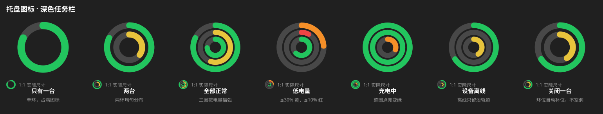
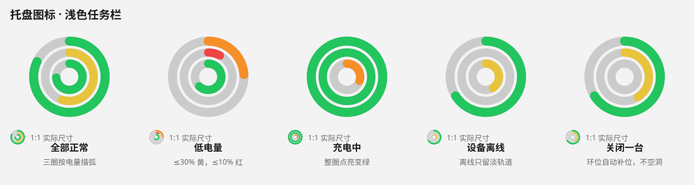
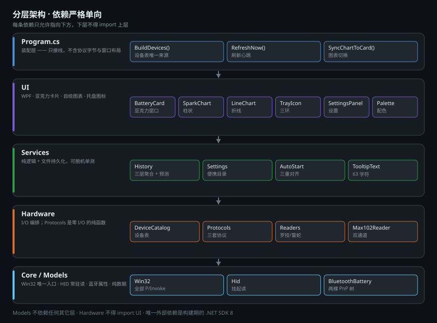
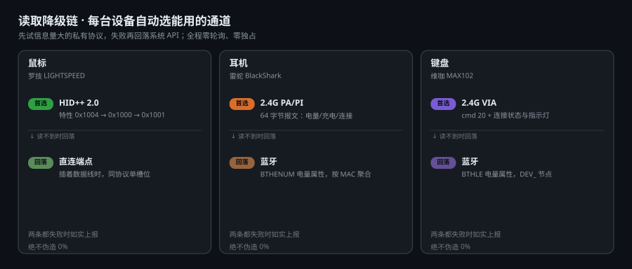
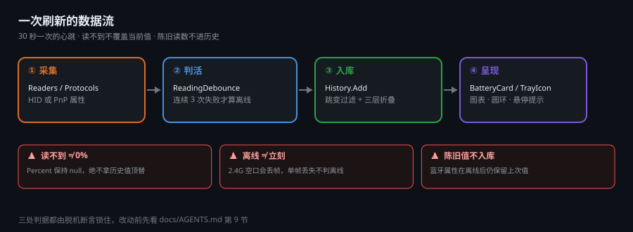

<div align="center">

# 外设电量 · Peripheral Battery

**一个托盘图标，盯住所有无线外设的电量。**<br>
罗技 HID++ · 雷蛇 PA/PI · VIA/QMK 键盘 · 任意蓝牙外设 —— 私有协议优先，失败自动回落系统 API。

[](#构建)
[](#构建)
[](#授权)
[](#设计约束)
[](#性能)
[](#测试)
[](#兼容性)


<sub>任务栏上只有一个图标，三圈同心环对应三台设备；弧长即电量。<br>
下面是卡片界面 👇</sub>

</div>

---

## 目录

- [它解决什么问题](#它解决什么问题)
- [功能](#功能)
- [界面](#界面)
- [托盘图标](#托盘图标)
- [架构](#架构)
- [工作原理](#工作原理)
- [历史数据](#历史数据)
- [设备管理](#设备管理)
- [兼容性](#兼容性)
- [添加设备型号](#添加设备型号)
- [便携模式](#便携模式)
- [构建](#构建)
- [测试](#测试)
- [性能](#性能)
- [设计约束](#设计约束)
- [已知限制](#已知限制)
- [文档](#文档)
- [授权](#授权)

---

## 它解决什么问题

Windows 自带的蓝牙电量只在「设置 → 蓝牙」里，一关窗口就看不见；2.4G 接收器的
设备电量则压根没有系统 UI。多台外设各查一遍，实际使用中没人会这么做。

这个工具把**鼠标、耳机、键盘、手柄**的电量收进一个托盘图标，左键单击展开
卡片看历史与续航预测。设备离线、丢帧、固件读不到时，它如实告诉你原因，
而不是显示一个看起来正常但其实是假的百分比。

支持的协议与型号见 [兼容性](#兼容性) —— 按**证据等级**分级：
哪些是作者每天在用的实测型号，哪些只是「同协议族、未验证」，
一眼能分清。

## 功能

| | 能力 | 说明 |
|---|---|---|
| 🎯 | **单图标多设备** | 同心环按启用顺序排列；关掉中间那台设备，环位自动补位，不留空洞 |
| 📊 | **柱状 + 折线双视图** | 柱状看每小时分布，折线看长期趋势；两者共用 24h / 7d / 30d / 1y / 2y 时间轴 |
| 🔋 | **续航预测** | 按 24 小时放电斜率估算剩余时间，附置信度与前 24 小时区间 |
| 🔀 | **多通道自动降级** | 私有协议优先，失败回落系统 API；读不到就如实报错，不编数字 |
| 🧩 | **设备表驱动** | 加型号只改一张表或一个 `devices.json`，不动任何代码 |
| 🪟 | **亚克力卡片** | DWM 硬件级毛玻璃 + 真圆角；系统不支持时自动退回不透明底板 |
| 🎨 | **跟随系统主题** | 浅色 / 深色自动切换，阈值配色可自定义 |
| 🔔 | **低电量提醒** | 任意设备 ≤10% 弹一次通知，回充后复位 |
| 💾 | **便携** | 设置 / 历史 / 日志都在 exe 旁边，整个文件夹拷走即用 |
| 🎛️ | **设备开关** | 关掉的设备完全不探测、不占环、不记历史；环位自动补位 |
| ♻️ | **托盘自愈** | explorer.exe 重启后图标自动重建（`WM_TASKBARCREATED`） |

## 界面

<table>
<tr>
<td align="center"><br>
<b>柱状图 · 24 小时</b><br><sub>每根柱是一小时的均值</sub></td>
<td align="center"><br>
<b>折线图 · 7 天</b><br><sub>刻度自动变为日期</sub></td>
<td align="center"><br>
<b>折线图 · 2 年</b><br><sub>只有真实数据的位置才有线</sub></td>
</tr>
<tr>
<td align="center"><br>
<b>折线图 · 24 小时</b><br><sub>充电段标绿，离线处断线</sub></td>
<td align="center"><br>
<b>浅色主题</b><br><sub>跟随系统自动切换</sub></td>
<td align="center"><sub>卡片高度随设备数自适应<br>离线设备保留「上次 xx% · N 小时前」</sub></td>
</tr>
</table>

> 以上均为真实渲染（`外设电量.exe --preview <路径> <bar|line> <小时>`），
> 用合成数据驱动，可在无设备环境下复现视觉改动。

## 托盘图标

托盘上只有**一个**图标：同心环，按启用顺序由外到内排列
（默认三台：外环鼠标、中环耳机、内环键盘）。
每圈按电量描弧 —— 满圈是 100%，半圈是 50%；离线设备只留极淡的轨道。

<p align="center"></p>

<p align="center"></p>

下面每格同时给出**放大 6 倍**与**1:1 实际尺寸**：24px 是任务栏上真实看到的
大小，三圈在这个尺寸下必须仍然可分。几何参数是按 24px 反推的
（半径 10.3 / 7.0 / 3.8，描边 2.6 / 2.4 / 2.4），相邻净间隙只有 0.8px ——
再粗一点三圈就会粘连成一坨。

四档配色：**充足 绿 → 一般 黄 → 偏低 橙 → 告急 红**，充电时整圈点亮变绿。
四个颜色必须能在 24px 上互相区分 —— 早期版本「一般」是橙、「偏低」是红、
「告急」是深红，后两者几乎一样，用户分不清「该充电了」和「马上要关机」。

充电之所以整圈点亮而不是只画到电量位置，是因为 24px 上根本看不出
「弧长了多少」。

> 上面是**矢量 SVG**：`外设电量.exe --tray <路径.svg> [--light]` 生成。
> 图标本身是纯几何（圆 + 圆弧），做成矢量后放大到任何尺寸都清晰 ——
> 位图在 24px 放大 10 倍只会得到马赛克。
> 几何参数直接读 `TrayIconArt.Default`，与真实托盘图标共用同一份定义，
> 不会出现「README 上的图和实际图标长得不一样」。
> 每格都给出放大版与 1:1 实际尺寸：24px 才是任务栏上的真实观感

## 架构

<p align="center"></p>

依赖严格单向，下层不得 import 上层：

```
Program  →  UI  →  Services  →  Hardware  →  Core  →  Models
```

- **Models** 纯数据与纯换算，零 I/O —— 因此能被脱机单测直接导入
- **Core** 是全项目唯一的 P/Invoke 入口（`Win32.cs`）
- **Hardware** 里 `Protocols.cs` 是零 I/O 的纯函数，`Readers.cs` 才碰句柄
- **Program.cs** 只做装配：设备清单只出现在 `BuildDevices()` 一处

## 工作原理

### 读取降级链

<p align="center"></p>

每台设备先试信息量最大的私有协议，失败才回落系统 API：

| 设备 | 首选通道 | 回落通道 |
|---|---|---|
| 罗技鼠标 | HID++ 2.0 特性 `0x1004` → `0x1000` → `0x1001` | 直连端点（插着数据线时） |
| 雷蛇耳机 | 2.4G PA/PI 64 字节中断报文 | 蓝牙 `BTHENUM` 电量属性 |
| 维咖键盘 | 2.4G VIA `cmd 20` | 蓝牙 `BTHLE` 电量属性 |

蓝牙通道有个坑值得单说：耳机的电量挂在**经典蓝牙音频服务子节点**上，
而那个节点的 `IsConnected` 恒为 `False`；真正表示链路在线的是同 MAC 的
父节点，它**没有**电量。所以在线状态必须按 MAC 聚合，拿子节点的标志
当结论会在耳机正放着歌时显示「离线」。

### 一次刷新

<p align="center"></p>

三条护栏都是踩坑后加的，每条都有对应断言锁住：

- **读不到 ≠ 0%** — `Reading.Percent` 保持 `null`，历史值只进「上次 77%」
- **离线 ≠ 立刻** — 2.4G 空口丢帧常见，连续 3 次失败才判离线
- **陈旧值不入库** — 蓝牙属性在设备离线后仍保留上次值，写进历史会伪造水平曲线

## 历史数据

<p align="center"></p>

「看 24 个月趋势」不能靠堆原始样本：30 秒一条算下来是 630 万条、约 150 MB。
改为三层折叠，**总计约 200 KB/设备**：

| 层级 | 保留 | 每条间隔 | 体积 | 服务于 |
|---|---|---|---|---|
| 原始样本 | 48 小时 | 20–30 秒 | ~150 KB | 折线图、24h 柱状图、续航预测 |
| 小时聚合 | 30 天 | 1 小时 | ~30 KB | 7 天 / 30 天窗口 |
| 天聚合 | **24 个月** | 1 天 | ~30 KB | 1 年 / 2 年窗口 |

几个刻意的取舍：

- **电量取区间平均，不取末值。** 聚合后单点会随机跳动，取末值会让折线
  按采样时间抖动。24 小时视图下两者等价（每桶只有一条）。
- **空段不补点。** 设备关机 3 天就是相邻两点隔 3 天，折线在那里断开。
  补出来的点会把「关机三天」画成电量平稳的直线。
- **横轴按真实时间映射。** 只按数组下标摆点时，「2 年窗口里只有 24 小时
  数据」会被拉伸铺满整条横轴，看起来像两年的趋势。

## 设备管理

设备会越接越多，但常用的就那几台。设置面板里的「设备」一节可以逐台开关：

```text
设备
  鼠标        ☑
  耳机        ☐   ← 关掉
  键盘        ☑
```

关闭是**彻底不参与**，不是「隐藏」：

| | 关闭监控 | 离线 |
|---|---|---|
| HID / PnP 探测 | **完全不发** | 每轮都试，等它回来 |
| 托盘环 | 不占，后面的设备补位 | 占位，只画淡轨道 |
| 卡片与悬停提示 | 不出现 | 出现，标「离线」 |
| 历史记录 | 不再写入 | 不写入（但保留已有） |
| 低电量提醒 | 不参与 | 参与 |

补位这一点值得说明：关掉中间那台之后，环数会从 3 变成 2，而不是留一个
永远空着的同心环 —— 否则用户会以为「那里还有台设备但读不到」。响应也比
「下一轮刷新才停」更及时：开关一改就立刻重算环位并重画。

设置项落在 `settings.json` 的 `disabled_devices`（存 history key 而不是显示名，
因为名字会改，key 是稳定的文件标识）。手改配置留下空串或重复项时，
`Sanitize()` 会清掉。

## 兼容性

设备清单按**证据等级**分层，不把「协议理论上支持」写成「已验证」：

| 等级 | 含义 |
|:---:|---|
| 🟢 **实测** | 作者每天在用，型号 / 电量 / 充电全部验证 |
| 🟡 **协议族兼容** | 同一协议同一报文格式，协议层有断言，但没在真机验证这个型号 |
| 🔵 **仅蓝牙** | 只有系统电量属性可用，拿不到充电状态 |
| ⚪ **未测试** | 型号存在、协议对得上，但没有任何证据 |

### 实测（🟢）

| 设备 | VID:PID | 通道 |
|---|---|---|
| 罗技 PRO X 2（G PRO X SUPERLIGHT 2） | `046D:C54D` | HID++ 2.0 |
| 罗技 G304 / G102 Lightspeed | `046D:C53F` | HID++ 2.0 |
| 雷蛇 BlackShark V2 Pro（旋风黑鲨 2.4G 2023） | `1532:0555` | PA/PI 2.4G + 蓝牙 |
| 维咖 MAX102 | `342D:E537` | VIA `cmd 20` + 蓝牙 |

### 协议族兼容（🟡）

<details>
<summary><b>罗技 LIGHTSPEED</b> —— 走 HID++ 2.0 标准电量特性链（展开）</summary>

`0x1004` UNIFIED_BATTERY → `0x1000` BATTERY_STATUS → `0x1001` BATTERY_VOLTAGE

| 型号 | VID:PID |
|---|---|
| G502 X PLUS | `046D:C095` |
| G502 LIGHTSPEED | `046D:C539` |
| G PRO X Wireless 耳机 | `046D:0ABA` |
| G703 / G903 / G604 / G603 | `046D:C539` 族 |
| G913 / G915 / G515 TKL | — |

> 罗技这条链是**官方规范**，支持 HID++ 2.0 的设备理论上都能读。
> 罗技还会用 `0x0005` 特性自报真名，所以型号名不依赖 PID 表。
</details>

<details>
<summary><b>雷蛇</b> —— 走 PA/PI 64 字节中断报文（60 个 PID 已入表）</summary>

耳机：Kraken V4 `056C`、Kraken 7.1 系列 `0501/0504/0506/0510/0520/0527`、
Kraken Kitty `0F19/0560`

鼠标（部分）：DeathAdder V4 Pro `00BE`/`00EF`、V3 Pro `00B6`、V2 Pro `007C`、
V2 X HyperSpeed `009C`、Viper V4 Pro `00E5`、V3 Pro `00C0`、V3 HyperSpeed `00B8`、
V2 Pro `00A5`、Basilisk V3 Pro `00AA`/`00CC`/`00D6`、Naga V2 Pro `00A7`、
Mamba `0073`、Lancehead `0059`/`0070`、Cobra `00AF`/`00DA`、
Orochi V2 `0094`、Pro Click `0077`/`009A`/`00D0`、HyperPolling Dongle `00B3`

PID 来自 [OpenRazer](https://github.com/openrazer/openrazer) 的公开设备清单，
**电量命令的语义未在本仓库逐个验证**。型号表只决定显示的名字 ——
表里没有的 PID 会读 `product_string`，读不到就显示「Razer 无线设备」，
电量照读不误。
</details>

<details>
<summary><b>QMK / VIA 键盘</b> —— 两个已知布局（展开）</summary>

同一端点 `0xFF60/0x61`、同样 33 字节，差别只有命令号与电量偏移：

| 布局 | 命令 | 电量偏移 | 型号 | 性质 |
|---|:---:|:---:|---|---|
| A | `0x14` | `[4]` | 维咖 MAX102 | 补丁命令，原厂回 `0xFF` |
| B | `0x20` | `[3]` | 高斯 GS3108T-PRO | 原厂命令，默认不启用 |

补丁参考 [weikav-max102-re](https://github.com/Banxiaxiala/weikav-max102-re)。
原厂固件回 `0xFF` 时本程序如实报「固件没有电量补丁」，绝不显示 0%。
</details>

### 移植实现（🟡 未验证）

以下协议移植自公开参考实现，代码已接入并通过断言，但**作者没有这些设备**：

| 品牌 | 型号 | 协议 |
|---|---|---|
| 高斯 | GS3108T-PRO | VIA 布局 B（cmd `0x20`） |
| ATK / 怒喵 | V75X | ATK 私有 64B（`0xFF1C/0x92`） |
| 飞智 | GPA6 | Flydigi 私有（`0xFFA0`） |
| 漫步者 | 花再 Halo Space | Edifier EC（XOR `0xA5` + 累加和） |
| 迈从 | A5 V2 Ultra / G75 PRO / G87 V2 | 迈从 Feature（全帧 XOR `0xFF`，走 Feature Report） |
| 盖世小鸡 | 启明星2 手柄 | GameSir 65B（255 = 充电中无百分比） |
| 华硕 ROG | PELTA 耳机 / Scope II RX | ROG 64/65B（`CC 12` 帧头） |
| HyperX | 飓风3 无线耳机 | HyperX 62B（report id `0x66`） |
| 宏碁 | VK M3 / OMR331 | Acer 33B（充电时填 100 当哨兵） |
| 迈从（键盘） | G75 PRO / G87 V2 / Z75S | 迈从键盘 0x13 帧（G75 PRO 只收 20 字节） |
| NuPhy | Air75 V2 / Halo75 V2 / WH80 | NuPhy 65B（两步：先读模式再算偏移） |

**全部默认关闭**，装了的用户在设置面板里打开。
这些设备报 issue 时请务必附 `--probe --trace` 输出 —— 没有真机验证过的
协议最需要的就是「第一次真实运行的结果」。

> 移植时踩到的十三个坑（report id、4 位电量、掩码范围、缓冲区残留、
> Feature Report 时序、255 哨兵、占位伪应答、100 哨兵、命令字节扫描、
> 同厂商两套协议、20 字节端点、bit7 标志位、两步读偏移）
> 记在 [docs/COMPATIBILITY.md](docs/COMPATIBILITY.md)。

### 通用蓝牙（🔵）

**任意品牌**已配对、且 Windows「设置 → 蓝牙」里显示百分比的外设都能读 ——
读的是系统属性 `{104EA319-6EE2-4701-BD47-8DDBF425BBE5} 2`，不走厂商协议。
耳机走 `BTHENUM` 音频服务节点，键鼠走 `BTHLE`。

固有局限：**拿不到充电状态**、电量是系统缓存的（离线后仍保留旧值）、
按名字前缀匹配设备。

> 📋 完整矩阵（含未测试型号、每个通道的限制、数据来源）
> 见 **[docs/COMPATIBILITY.md](docs/COMPATIBILITY.md)**。

## 添加设备型号

设备清单是**数据**，不是代码分支。想加一台设备，有两种方式：

### 同协议的其它型号 —— 不用改代码

在 `data\devices.json` 里写一条就行，重编译都不需要：

```json
[
  {
    "key": "g304",
    "label": "备用鼠标",
    "model": "G304",
    "channels": [
      { "kind": "logitech", "vendorId": 1133 }
    ]
  }
]
```

`kind` 支持宽松写法：`logitech` / `razer` / `via` / `bluetooth`，
也接受严格写法 `LogitechHidpp` / `RazerPaPi` / `ViaQmk` / `BluetoothProperty`。

一条设备可以有**多条通道**，按顺序试，第一条读到就停：

```json
{
  "key": "my-headset",
  "label": "耳机",
  "model": "某款雷蛇耳机",
  "channels": [
    { "kind": "razer", "vendorId": 5410 },
    { "kind": "bluetooth", "namePrefix": "Razer",
      "classicBluetoothOnly": true, "model": "某款雷蛇耳机" }
  ]
}
```

> `kind: "bluetooth"` 必须给 `namePrefix`，因为系统属性只能靠名字找设备。
> `classicBluetoothOnly` 决定扫哪棵树：耳机是 `true`（BTHENUM），
> 低功耗键盘是 `false`（BTHLE）。

校验偏严是故意的：**宁可不加，也不要加一条读不出数据的设备** ——
一条永远失败的设备会在托盘上留一个永久空环，用户第一反应是「工具坏了」
而不是「我配错了」。所以下列情况会被跳过（并在 `--trace` 日志里写明原因）：

- 缺少 `key` 或 `label`
- 没有任何可用通道
- `key` 与内置设备重名，或与其它自定义项重复
- 协议名不认识

### 全新协议 —— 改一张表

真正要对接一套新协议时：

1. `src/Hardware/Protocols.cs` 加**纯解析函数**（只吃字节、只吐值，零 I/O）
2. `src/Hardware/Readers.cs` 加 I/O 编排，暴露一个 `Read()` 方法
3. `src/Hardware/DeviceCatalog.cs` 的 `BuiltIn` 里加一条声明
4. `src/Hardware/DeviceBinder.cs` 补一个 `case`（只在引入**新协议类型**时才需要）
5. 抓包帧补进 `tests/ProtocolTests.cs` 做断言

`Program.cs`、卡片、托盘、历史**一行都不用改** —— 它们只认
`DeviceDefinition`，不认具体型号。

## 便携模式

数据默认写在 **exe 旁边的 `data\`**：

```
外设电量.exe
data\
  settings.json
  history_logitech.json      ← 原始 + 小时聚合 + 天聚合，同一个文件
  history_razer.json
  history_max102.json
  logs\trace.log             ← 仅 --trace 时写入，超过 2 MB 滚动一次
```

把整个文件夹拷到 U 盘或另一台电脑即可带走全部设置与历史。

程序目录不可写时（例如放在 `C:\Program Files`）自动回退到
`%LOCALAPPDATA%\外设电量`，不会启动失败。可写性用**实际创建并删除一个文件**
来探测 —— 只看目录属性会被 ACL 骗过。

旧版本留在 `%LOCALAPPDATA%` 的历史会在首次进入便携模式时自动迁入，
且**不覆盖便携目录里已有的较新数据**。

## 系统要求

| 项 | 要求 |
|---|---|
| 操作系统 | Windows 10 1809+ / Windows 11（需要 DWM 亚克力；不支持时自动退回不透明底板） |
| 运行时 | .NET 8 **Desktop** Runtime（多数 Win11 已自带；未自带会提示下载） |
| 架构 | x64 |
| 构建 | .NET SDK 8（仅开发时需要） |

无需管理员权限、无需安装服务，解压即用。

## 构建

需要 **.NET SDK 8**（唯一的外部依赖，仅构建期）。装好后：

```bat
build.bat
```

产物 `dist\外设电量.exe`，双击即用。

`build.bat` 会自动完成：定位装了 SDK 的 `dotnet` → 结束正在运行的实例 →
跑单元测试 → 编译 → 单文件发布。任一步失败都会中止，不会留下过期的 exe。

<details>
<summary>分步执行</summary>

```bat
rem 单元测试（127 项，零硬件、零第三方框架）
dotnet run --project tests\PeripheralBattery.Tests.csproj

rem 只打印一次读数，验证协议是否还通
dotnet run --project src\PeripheralBattery.csproj -- --probe

rem 加上 --trace 看每一帧 HID 收发（同时写 data\logs\trace.log）
dotnet run --project src\PeripheralBattery.csproj -- --probe --trace

rem 离线渲染卡片截图，调视觉时用
dotnet run --project src\PeripheralBattery.csproj -- --preview card.png line 168
```

</details>

## 测试

```bat
dotnet run --project tests\PeripheralBattery.Tests.csproj
```

**218 项脱机断言，零硬件依赖。** 不用 xunit / nunit / MSTest ——
`tests/Harness.cs` 里 60 行手写运行器就够，`Main` 返回非 0 表示失败。

覆盖面：

| 领域 | 断言锁住什么 |
|---|---|
| 协议解析 | 真机抓包帧的字节布局，改协议立刻失败 |
| 历史与聚合 | 折叠、加权合并、重采样、v1 文件兼容、Flush 不清空历史 |
| 防抖与状态 | `-1`（没问到）不得当 `0`（休眠）用；丢一帧不算离线 |
| 图标几何 | 三环槽位、阈值配色边界 |
| 设置校验 | 越界值拉回合法范围，阈值严格递增 |
| 提示文本 | 63 字符上限，标题永不被裁掉 |

## 性能

| 指标 | 数值 |
|---|---|
| 单文件 exe | 492 KB（framework-dependent） |
| 运行时代码 | 约 9,100 行（25 个文件） |
| 内存占用 | 私有约 39 MB / 工作集约 94 MB（WPF + 亚克力实测） |
| 罗技读取 | ~130 ms（含两遍槽位探测） |
| 雷蛇 2.4G / 蓝牙 | ~55 ms / ~8 ms |
| 维咖 VIA / 蓝牙 | ~30 ms / ~5 ms |
| 默认刷新间隔 | 30 秒（可调 10–600 秒） |
| 空槽位排除 | ~6 ms/槽位 |

读取在 UI 线程同步执行。一次完整刷新约 200 ms，三台设备都在时仍然可接受；
**设备多了会线性叠加** —— 因为未接的设备也会走一遍超时探测。
这是当前最该改的性能点：正确做法是后台线程 + 结果回投，
并让「已关闭」的设备完全不参与（这一条已经实现）。

## 设计约束

以下是硬约束，不是偏好：

- **零第三方运行时依赖。** 只用 BCL + WPF + Win32 P/Invoke。每引入一个包，
  体积、启动时间与崩溃面都会变差。
- **设备清单只有一处。** 只允许出现在 `Program.BuildDevices()`。
  历史版本把「鼠标 / 耳机」写成两组平行字段，加第三台设备要改 11 处、
  漏一处就静默不显示。
- **图标用 Path 画，不用字体字形。** 图标字体的码点在不同 Windows 版本上
  会渲染成完全不相干的东西。
- **每个开关必须有即时可见的回执。** 只写配置文件而不改界面外观，
  用户会认为「这个按钮没用」。

## 已知限制

| 限制 | 说明 |
|---|---|
| 逐型号逆向 | 换设备需重新抓包验证，没有通用自动发现 |
| 蓝牙通道拿不到充电状态 | 系统属性 `{104EA319-…} 3` 实测恒缺失，只能写「充电状态未知」 |
| 蓝牙按名字前缀识别 | 耳机 `Razer*`、键盘 `MAX102*`。不按 MAC 是因为 MAC 随重配对变化 |
| 续航预测需 30 分钟样本 | 刚装好会显示「放电数据积累中」 |
| 有线模式下读不到无线那端 | 物理限制：插线后设备不再通过 2.4G 上报 |
| 只测过 3 款设备 | 罗技 PRO X 2、雷蛇 BlackShark V2 Pro、维咖 MAX102 |

## 文档

| 文档 | 内容 |
|---|---|
| [docs/README.md](docs/README.md) | 完整使用说明、设置项、协议字节布局、适配新设备 |
| [docs/ARCHITECTURE.md](docs/ARCHITECTURE.md) | 分层、关键设计决策的理由、线程模型、协议速查 |
| [docs/HANDOVER.md](docs/HANDOVER.md) | **接手先读这个**：装环境、改代码、排查手册 |
| [docs/AGENTS.md](docs/AGENTS.md) | 维护铁律（AI / 开发者共同遵守） |

## 关于这些图

示意图（架构 / 降级链 / 数据流 / 存储分层）是 **SVG**，由
`tools/draw_diagrams.py` 生成 —— 浏览器矢量渲染，缩放不糊，单张只有
3–9 KB。卡片与托盘图是 PNG，因为它们要展示真实像素渲染结果，必须光栅。

```bat
py -3.13 tools\draw_diagrams.py          rem 只出 SVG
py -3.13 tools\draw_diagrams.py --png    rem 同时出 PNG（本地预览用）
```

`--preview` / `--tray` 生成界面截图，都是离线合成数据，不需要真机。

## 致谢

这个项目的协议实现几乎全部站在别人肩上。下面按「我们具体用了什么」列，
并标明各自许可证 —— 因为本项目是 GPL-3.0 派生作品，这些归属是**法律要求**
而不只是礼貌。

### 代码来源谱系

```
yszyszysz233/2.4G-battery-viewer    ← 最初的灵感与方法论（Prompt 驱动逆向）
        │                            无许可证
        ↓
marsuyone/mchose-battery-tray       ← 第一版 C#/托盘实现
        │                            无许可证
        ↓
Banxiaxiala/mchose-battery-tray      ← 本项目（演进为多协议 + 历史图表）
                                      GPL-3.0
```

| 项目 | 许可证 | 我们用了什么 |
|---|---|---|
| [2.4G-battery-viewer](https://github.com/yszyszysz233/2.4G-battery-viewer) | 无 | **方法论来源**：把「枚举 HID → 抓包 → 试命令 → 爆破校验」这套逆向流程写成可复用的 Prompt。<br>本项目沿用了它的核心思路：**协议靠实测，不靠猜**。 |
| [marsuyone/mchose-battery-tray](https://github.com/marsuyone/mchose-battery-tray) | 无 | **本仓库的 fork 上游**：单图标多圆环的托盘外观、主题跟随、单实例。<br>本项目的 git 历史前两个提交即出自该作者。 |

> ⚠️ 这两个上游**没有声明许可证**。「无许可证」默认保留所有权利 ——
> 本项目在它们基础上做了大量演进（多协议、三层历史、设备表驱动），
> 并选择以 GPL-3.0 发布。如果上游作者对此有异议，请联系调整。
>
> **⚠️ 不要点 GitHub 的「Sync fork」**：上游是 Python 实现、无许可证，
> 本仓库是重写的 C#/GPL-3.0 版本，两者没有可合并的代码。
> 同步会把上游的 Python 文件合并进来，且引入许可证冲突。

### 代码移植（GPL-3.0 派生来源）

| 项目 | 许可证 | 我们用了什么 |
|---|---|---|
| [FerrisPulse](https://github.com/Ferris-echo/FerrisPulse) | GPL-3.0 | **协议代码的主要来源**：<br>· 雷蛇 64 字节 PA/PI 报文格式<br>· ATK 私有协议（`0xFF1C/0x92`）<br>· 飞智 GPA6 私有帧（`0xFFA0`）<br>· 漫步者 EC 帧（XOR `0xA5` + 累加和）<br>· 高斯 GS3108T-PRO 的 VIA 布局 B<br>· 各家 PID 与实测型号清单 |
| [logi-tray](https://github.com/yixing233/logi-tray) | GPL-3.0 | 罗技 HID++ 2.0 的两遍槽位探测、短集合错误帧判定、<br>24 小时分桶与续航预测算法、亚克力卡片视觉规格 |

### 数据与参考（未复制代码）

| 项目 | 许可证 | 我们用了什么 |
|---|---|---|
| [OpenRazer](https://github.com/openrazer/openrazer) | GPL-2.0 | 雷蛇 PID 清单（`daemon/openrazer_daemon/hardware/`）。<br>**只取了 VID/PID 与型号名这类事实性数据**，没有复制实现代码 |
| [weikav-max102-re](https://github.com/Banxiaxiala/weikav-max102-re) | 见仓库 | **本项目作者自己的**维咖 MAX102 固件逆向：电量通路反汇编图、<br>`cmd 20` 补丁的字节布局与实测帧、可直接刷入的补丁固件 |

> 从 OpenRazer 取的是「某 PID 对应某型号」这种事实，不构成对其代码的派生；
> 但从 FerrisPulse / logi-tray 取的是**实现**，所以我们沿用 GPL-3.0。

### 一个必须说清的限制

移植的协议（ATK / 飞智 / 漫步者 / 高斯）**没有在本仓库对应的真机上验证过**。
上游项目对各自型号做过抓包，我们照搬了帧格式并补了断言，
但「上游验证过」不等于「这里也能用」。这些设备默认关闭，
详见 [docs/COMPATIBILITY.md](docs/COMPATIBILITY.md)。

## 授权

本项目采用 **GNU General Public License v3.0**，全文见 [LICENSE](LICENSE)。

之所以是 GPL-3.0 而不是 MIT：`src/Hardware/VendorProtocols.cs` 与
VIA / HID++ 的读取逻辑移植自 GPL-3.0 项目（见上方致谢），
派生作品必须沿用同一许可证。这不是偏好问题。

与罗技、雷蛇、维咖、ATK、飞智、漫步者等厂商官方无关，
不保证适配其他型号或固件版本。
