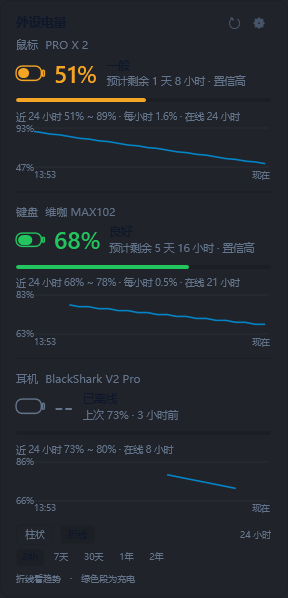

# 外设电量

> 罗技 LIGHTSPEED 鼠标 + 雷蛇耳机（2.4G / 蓝牙）+ 维咖 MAX102 键盘（2.4G / 蓝牙）
> 的电量托盘监控。
> 只占**一个**托盘图标（三圈同心环），**左键单击**弹出亚克力卡片看
> 24 小时历史与续航预测。
>
> C# + WPF 实现，单文件 exe 约 **494 KB**，零第三方运行时依赖。
> 采用 GPL-3.0（派生自 FerrisPulse / logi-tray，见根目录致谢）。
>
> 旧名「2.4G 设备电量」（v3）。改名只影响 exe 名与数据目录，
> 首次启动会自动把 `%LOCALAPPDATA%.4G设备电量\` 整目录搬到
> `%LOCALAPPDATA%\外设电量\`，历史曲线不丢。



> 完整界面截图与架构图见仓库根目录的 [README.md](../README.md)。

## 特性

- **一个托盘图标**：三圈同心环 —— 外环鼠标、中环耳机、内环键盘，细线风格跟系统图标一致
- **左键单击**弹卡片（右键才是菜单），卡片贴在图标正上方
- **亚克力毛玻璃卡片**：10px 圆角 + 1px 描边 + DWM 硬件级虚化
- 卡片内含：电池图标、大号电量、充放电档位、**续航预测**、动画进度条、
  **每台设备各一张历史图：柱状图 / 折线图可切换**
- 跟随系统浅色/深色主题自动切换
- 图标配色：**≤30% 变黄、≤10% 变红**，充电时整圈点亮并变绿
- 悬停显示型号、电量、充放电状态、预计剩余时间
- 任意设备 **≤10%** 弹一次托盘通知（回充后复位）
- **设置面板**可调：刷新间隔、卡片宽度、图表高度、开机自启、低电量提醒、跟随主题
- 设备离线时保留上次读数并标注「(离线)」，同时给出「上次 77% · 2 小时前」
- **耳机 / 键盘都支持蓝牙模式**：蓝牙下自动从 Windows 电量属性读取
- explorer.exe 重启后托盘图标自动重建（`WM_TASKBARCREATED` 自愈）

## 历史数据

卡片底部可以切换 **柱状图 / 折线图**，两种样式都能选时间跨度：
24 小时、7 天、30 天、1 年、2 年。

- **柱状图**看分布：每根柱是一段时间的平均值，柱子数量固定 24 根，
  柱宽随时间跨度自动变化（24 小时视图下每根柱 1 小时，7 天视图下每根柱 7 小时）。
  卡片上会写明「每柱 X 小时」，避免误读。
- **折线图**看趋势：连续变化、充电段标绿、设备离线处断线。

数据分三层保存，所以「看两年趋势」不会让文件涨到几十 MB：

| 层级 | 保留 | 每条间隔 | 每设备体积 |
|---|---|---|---|
| 原始样本 | 48 小时 | 20~30 秒 | ~150 KB |
| 小时聚合 | 30 天 | 1 小时 | ~30 KB |
| 天聚合 | **24 个月** | 1 天 | ~30 KB |

几条刻意的设计：

- **电量取区间平均值**，不取末值。聚合后单点会随机跳动，取末值会让
  折线按采样时间抖动，看不出真实趋势。
- **空段不补点**。设备关机 3 天就是相邻两点隔 3 天，折线在那里断开。
  补出来的点会把「关机三天」画成电量平稳的直线。
- **横轴按真实时间映射**。只按数组下标摆点时，「2 年窗口里只有 24 小时
  数据」会被拉伸铺满整条横轴，看起来像两年的趋势 —— 实际只有一天。
- **折线用中性蓝，充电段用绿**。电量的「高」档颜色和「充电」是同一个
  绿色，用高低档配色画折线会让整条线看起来都在充电。

## 便携模式

数据默认写在 **exe 旁边的 `data\`**，整个文件夹拷到 U 盘或另一台电脑就能带走：

```
外设电量.exe
data\
  settings.json
  history_logitech.json
  history_razer.json
  history_max102.json
  logs\trace.log          ← 仅 --trace 时写，超过 2 MB 滚动一次
```

程序目录写不进去（比如放在 `C:\Program Files`）会自动回退到
`%LOCALAPPDATA%\外设电量`，不会启动失败。旧版本留在
`%LOCALAPPDATA%\外设电量` 的历史会在首次运行便携模式时自动迁过来，
且**不会覆盖便携目录里已有的较新数据**。

## 快速开始

需要 **.NET SDK 8**。装好之后：

```bat
build.bat
```

产物：`dist\外设电量.exe`（双击即用，不依赖 .NET 安装即可运行，
依赖系统已带的 WindowsDesktop 运行时）。

### 分步执行

```bat
rem 跑单元测试（106 项，零硬件）
dotnet run --project tests\PeripheralBattery.Tests.csproj

rem 只打印一次读数，验证协议是否还通
dotnet run --project src\PeripheralBattery.csproj -- --probe

rem 起托盘
dotnet run --project src\PeripheralBattery.csproj
```

真机探测输出：

```
设备探测
============================================================

[鼠标]
  PRO X 2
    协议    HID++
    电量    49%
    状态    放电中
    在线    是

[耳机]
  BlackShark V2 Pro
    协议    PA-PI
    电量    38%
    状态    放电中
    在线    是

[键盘]
  维咖 MAX102
    协议    VIA
    电量    100%
    状态    已连接
    在线    是

[蓝牙电量属性]
  MAX102-BT1  C0:06:72:D9:96:23
    电量    100%
    更新    2026-11-10 22:44:07
    在线    是
  Razer BlackShark V2 Pro BT Hands-Free AG  44:5E:CD:40:7C:2A
    电量    100%
    更新    2026-11-13 12:03:54
    在线    是
```

> 耳机和键盘都会按通道自动降级：耳机插着 dongle 时走 `PA-PI`，
> 否则读蓝牙；键盘插着 dongle / 有线时走 `VIA`，否则读蓝牙。
> 实际走的哪个通道写在输出的「协议」一行里。

## 用法

| 操作 | 效果 |
|---|---|
| 左键单击图标 | 弹 / 关卡片 |
| 右键 | 查看电量详情 / 立即刷新 / 开机自启 / 退出 |
| 卡片右上角 ↻ | 立即刷新 |
| 卡片右上角 ⚙ | 打开设置面板（贴在卡片左侧） |
| 设置里点色块 | 循环切换该档位的预设色 |
| 点卡片外侧任意位置 | 收起卡片（点其他程序窗口也会收起） |

> **托盘图标可能被折叠**：Windows 默认把新图标放进「^」里。
> 想直接看到它，从「^」把图标拖到任务栏上固定即可。

## 设置项

设置保存在 `%LOCALAPPDATA%\外设电量\settings.json`：

| 键 | 范围 / 取值 | 说明 |
|---|---|---|
| `interval` | 10–600 秒 | 采样间隔。太稀会让历史柱状图与续航预测失真 |
| `card_width` | 240–420 px | 卡片宽度。太窄会让型号名被省略号截断 |
| `chart_height` | 34–110 px | 历史图高度 |
| `chart_style` | `bar` / `line` | 默认图表样式 |
| `chart_range_hours` | 24 / 168 / 720 / 8760 / 17520 | 图表时间跨度（柱/折线共用） |
| `card_height` | `0` 或 240–900 px | 卡片高度。**`0` = 随内容自动**（推荐）；固定后内容可滚动 |
| `low_notify` | 开关 | 低电量提醒 |
| `follow_theme` | 开关 | 关掉则托盘图标固定用白线 |
| `color_high` | `#RRGGBB` 或留空 | 充足配色 |
| `color_mid` | 同上 | 一般配色 |
| `color_low` | 同上 | 偏低配色 |
| `color_critical` | 同上 | 告急配色 |
| `color_charging` | 同上 | 充电配色 |
| `threshold_critical` | 1–60 | 低于等于该值 = 告急 |
| `threshold_low` | 必须 > critical | 低于等于该值 = 偏低 |
| `threshold_mid` | 必须 > low | 低于等于该值 = 一般 |

配色项**留空即用内置默认**，解析失败也会回退默认 —— 手改 JSON 写错不会让界面变黑。
阈值会被自动拉成严格递增，传反了也不会出现「不可达档位」。

改完即时生效，不需要重启。也可以直接编辑 JSON 后重启程序。

## 项目结构
```
build.bat                 一键构建：定位 SDK → 杀进程 → 测试 → 编译 → 发布
src/                      生产代码
  Models/                 纯数据（Reading / Sample / Bucket / Forecast / Analysis）
  Core/                   Win32 P/Invoke + HID 句柄 + 蓝牙电量属性
  Hardware/               协议纯解析（Protocols）+ I/O 编排（Readers）
  Services/               历史与预测、设置持久化、三重自启动
  UI/                     配色、矢量图标、柱状图/折线图、亚克力、卡片、设置面板、托盘
  Tools/                  --preview：合成数据渲染卡片并截图
tests/                    106 项脱机断言（零硬件、零第三方框架）
docs/                     本文件、架构、交接、维护铁律
assets/                   README 用图
app.ico / icon.ico        应用图标
dist/                     构建产物（git 忽略）
```

分层与关键设计决策详见 [ARCHITECTURE.md](ARCHITECTURE.md)，
维护铁律详见 [AGENTS.md](AGENTS.md)，
**接手本项目请先读 [HANDOVER.md](HANDOVER.md)**。

## 协议

> 三套协议都是开源实现 / 固件反汇编 + 真机实测还原的，本机三台设备均已验证通过。

### 罗技 LIGHTSPEED（HID++ 2.0）

接收器暴露两个私有集合，**必须同时打开**：

| 集合 | usagePage / usage | 长度 | 用途 |
|---|---|---|---|
| 短 | `0xFF00 / 0x0001` | 7 | 判定「设备不在线」 |
| 长 | `0xFF00 / 0x0002` | 20 | 真正的请求/应答通道 |

请求帧：`11 <槽位> <特性索引> <(功能<<4)|软件ID> <参数…>`

- **软件 ID 必须非零**（这里用 `0x0A`）。设备主动推送的通知软件 ID 为 0，
  与功能 0 的应答字节完全相同，只有非零才能区分。
- 找设备要扫 1~7 号槽位。**关键优化**：目标槽位不可达时，接收器会在 3~5ms
  内从短集合回一条 `0x10` 错误帧 —— 认出它就不用为每个空槽位等满超时。
  实测 7 个槽位扫完只要 74ms。
- 电量特性按信息量优先回退：`0x1004` UNIFIED_BATTERY → `0x1000` BATTERY_STATUS
  → `0x1001` BATTERY_VOLTAGE（按 Solaar 放电曲线插值）。

本机实测（PRO X 2）：

```
请求 0x1004 GetFeature
11 01 00 0a 10 04 00 …        ← 发
11 01 00 0a 06 00 05 …        ← 回：特性索引 0x06

请求 GetCapabilities / GetStatus
11 01 06 0a 00 00 …           ← 能力：0F 0F 02 00 …（BIT(1)=直报百分比）
11 01 06 1a 00 00 …           ← 状态：35 04 00 00 …
                                     ↑0x35=53%  ↑0x04 = 放电中
```

### 雷蛇无线耳机（2.4G PA/PI 报文 + 蓝牙系统属性）

耳机有 **两种链路**，本程序自动选能用的那条：

| 通道 | 接口 / 来源 | 电量从哪来 |
|---|---|---|
| 2.4G（dongle） | `usagePage 0xFF00`，64 字节中断报文 | PA/PI `cmd 0x21` |
| 蓝牙 | 无厂商 HID 通道 | Windows 维护的 `DEVPKEY_Bluetooth_Battery` |

**2.4G 通道（PA/PI）**

接口 `usagePage 0xFF00`，输入/输出报告均为 **64 字节**，`FeatureReportByteLength = 0`
—— 所以 Feature Report 链路完全读不到它，必须走中断 OUT/IN。

```
命令  02 80 08 00 00 50 41 08 00 03 <CMD> 00 …
                    ↑ 'P''A'      ↑ 命令码
应答  02 0e 50 49 08 <4B 计数> 00 04 00 <CMD> 01 01 <value> …
            ↑'P''I'                          ↑状态  ↑电量
```

| 命令 | 用途 |
|---|---|
| `0x20` | 无线连接状态（0 = 耳机休眠/关机） |
| `0x21` | 电量百分比 |
| `0x2A` | 充电状态 |
| `0x00` | 序列号 |
| `0x2C` | 自动关机状态 |

本机实测（BlackShark V2 Pro 2.4）：

```
发送  02 80 08 00 00 50 41 08 00 03 21 00 …        (查电量)
应答  02 0e 50 49 08 c5 72 89 02 00 04 00 21 01 01 32 …
                                                      ↑0x32=50%
```

⚠️ `HidD_SetOutputReport` 会被固件拒绝（错误码 87），必须用 `WriteFile`。

**蓝牙通道**

蓝牙模式下耳机走标准 A2DP/HFP 服务，**没有**任何厂商 `usagePage 0xFF00`
接口，PA/PI 命令完全不通。此时读 Windows 自己维护的电量属性：

```
电量    {104EA319-6EE2-4701-BD47-8DDBF425BBE5} 2  →  Byte 0–100
时间戳  {104EA319-6EE2-4701-BD47-8DDBF425BBE5} 7  →  FILETIME
充电    {104EA319-6EE2-4701-BD47-8DDBF425BBE5} 3  →  实测恒缺失，如实显示「状态未知」
```

⚠️ **电量和链路状态不在同一个节点上**，这是蓝牙通道最容易踩的坑。
实测 BlackShark V2 Pro BT 的 PnP 节点树：

| InstanceId | 电量 | IsConnected |
|---|---|---|
| `BTHENUM\DEV_445ECD407C2A\…`（父节点） | **无** | **True** |
| `BTHENUM\{0000110B-…}_A2DP\…` | 无 | False |
| `BTHENUM\{0000111E-…}_Hands-Free AG\…` | **100%** | False |

所以：**电量按名字前缀找（`Razer…`），在线状态按 MAC 聚合**
（同一 MAC 任一节点在线即算在线）。拿服务子节点的 `IsConnected`
当结论，会在耳机正放着歌时显示「蓝牙离线」。

另外 `BTHENUM` 树下混着蓝牙串口 / 蓝牙鼠标 / 传真等大量无关节点，
必须按 `{0000xxxx-…}` 的音频服务 UUID（110A/110B/110C/110E/1108/1112/111E/111F）
先过滤，否则会把别的设备的电量串到耳机上。

### 蓝牙系统属性读取（耳机 / 键盘共用）

`Core/BluetoothBattery.cs` 会同时枚举 **`BTHLE`（低功耗）和 `BTHENUM`（经典蓝牙）**
两棵 PnP 树 —— 缺一棵就有一类设备永远读不到：

| 设备 | 枚举器 | 电量挂在哪个节点 |
|---|---|---|
| 耳机 BlackShark V2 Pro BT | `BTHENUM` | `Hands-Free AG` 服务子节点 |
| 键盘 MAX102-BT1 | `BTHLE` | `DEV_<MAC>` 父节点 |

### 维咖 MAX102 键盘（VIA / 蓝牙系统属性）

这块键盘有 **三种形态**，电量来源不同，本程序会自动选能用的那条：

| 通道 | 接口 / 来源 | 电量从哪来 | 能拿到的附加信息 |
|---|---|---|---|
| 2.4G（dongle） | `usagePage 0xFF60 / usage 0x61`，33 字节 | VIA `cmd 20` | 连接状态、模块版本、指示灯 |
| USB 有线 | 同上 | **拿不到**（`md_info` 全零） | 只能确认设备可达 |
| 蓝牙 | 无 VIA 通路 | Windows 维护的 `DEVPKEY_Bluetooth_Battery` | 只有电量 |


**2.4G / USB 通道（VIA）**

```
请求  00 14 00 00 …
应答  14 00 00 00 64 02 01 03 …
                  ↑  ↑  ↑  ↑
             电量100% │  │  └ 指示灯位图：bit0=Caps bit1=Num bit2=Scroll
             连接状态 2=CONNECTED   模块固件版本
```

| 偏移 | 含义 |
|---|---|
| `[0]` | 命令号回显，必须是 `0x14` |
| `[4]` | 电量 0–100 |
| `[5]` | 连接状态：0=未初始化 1=配对中 2=已连接 3=已断开 4=被拒绝 |
| `[6]` | 无线模块固件版本 |
| `[7]` | 指示灯位图 |

两个**必须写死的判据**（都是踩过坑才加的）：

1. **`cmd 20` 是补丁命令，不是原厂命令。**
   原厂固件对 `cmd > 19` 一律回 `0xFF`。见到 `0xFF` 只能判「固件没有电量补丁」，
   **绝不能当成 0%** —— 否则没刷补丁的用户会看到键盘永远 0% 并反复收到低电量提醒。
   补丁固件与逆向记录见
   [Banxiaxiala/weikav-max102-re](https://github.com/Banxiaxiala/weikav-max102-re)
   （`firmware/max102_patched_battery.bin`，含电量通路的反汇编分析图）。
2. **`cmd 6` 是「恢复出厂默认键位」，任何读取逻辑都不许碰它。**
   历史上有实现用 `cmd 6` 读电量，直接把该功能搞失效了。

**USB 有线模式下 `md_info` 全为零**（无线模块不工作），返回
`14 00 00 00 00 00 00 00`。这是正常现象，所以解析顺序必须是
**先看回显分「补丁有没有刷」→ 再看 `state` 分「当前模式有没有电量」**，
顺序反了会把「读不到」和「真 0%」混为一谈。

**充电状态：拿不到。** 主控固件里没有充电检测（X14076 的 `CHRG`/`STDBY`
直接驱动 LED），所以这台设备永远不显示「充电中」。

**蓝牙通道**

蓝牙下键盘的 7 个 HID 集合里**没有** `0xFF60/0x61`，厂商集合 `0xFF00`
也不回包 —— VIA 完全不通。但 Windows 自己维护 BLE 电量
（「设置 → 蓝牙」里那个百分比），直接读 PnP 属性即可：

```
节点    BTHLE\DEV_<MAC>                             ← 键盘的电量挂在父节点上
属性    {104EA319-6EE2-4701-BD47-8DDBF425BBE5} 2  →  Byte 0–100
时间戳  {104EA319-6EE2-4701-BD47-8DDBF425BBE5} 7  →  FILETIME
在线    {83DA6326-97A6-4088-9453-A1923F573B29} 15 →  Boolean
```

这么做而不是走 GATT 的三个理由：

- Windows 已经连着了，读属性毫秒级、不需要再连一次
- 走 GATT 要 BLE 栈（WinRT），会给单文件 exe 引入额外依赖
- 已配对的 BLE HID 被系统独占，抢连接会影响键盘输入

⚠️ 属性在设备**离线时仍保留上次的值**，必须连通状态一起判，
否则会把陈旧读数写进历史，伪造出一条水平曲线把续航预测的斜率算成 0。

### 适配其他设备

1. 把真机抓包帧补进 `tests/ProtocolTests.cs` 的断言
   （Python 侧 `archive/python-prototype/tests/test_protocols.py` 同步）
2. 在 `Hardware/Protocols.cs` 加纯解析函数
3. 在 `Hardware/Readers.cs` 接 I/O
4. 跑 `build.bat`，106 项测试要全过，再跑 `--probe` 验真机

## 实现参考

- [yixing233/logi-tray](https://github.com/yixing233/logi-tray) —— 罗技 HID++ 2.0
  的两遍槽位探测、短集合错误帧判定、各电量特性字节布局、24h 分桶与续航预测、
  以及这套亚克力卡片的视觉规格
- [Ferris-echo/FerrisPulse](https://github.com/Ferris-echo/FerrisPulse) —— 雷蛇
  64 字节 PA/PI 报文格式（`src/Hardware/RazerHeadsetHelper.cs`），
  以及本项目的工程规范（`AGENTS.md` / `AGENT_RULES.md`）
- [marsuyone/mchose-battery-tray](https://github.com/marsuyone/mchose-battery-tray) ——
  本项目的基础：单图标多圆环绘制、主题跟随、单实例
- [Banxiaxiala/weikav-max102-re](https://github.com/Banxiaxiala/weikav-max102-re) ——
  **本项目作者自己的**维咖 MAX102 固件逆向：WB32FQ95 / QMK / VIA v12 实机记录，
  `cmd 20` 电量补丁的字节布局与实测帧、蓝牙通道为何没有 VIA 通路、
  `DEVPKEY_Bluetooth_Battery` 的读取方式

## 文件说明

| 文件 | 用途 |
|---|---|
| `LICENSE` | GPL-3.0 全文 |
| `build.bat` | 一键构建（定位 SDK → 杀进程 → 测试 → 编译 → 发布） |
| `ARCHITECTURE.md` | 分层、关键设计决策、线程模型、协议速查、性能数据 |
| `COMPATIBILITY.md` | **兼容性矩阵**：哪些型号实测、哪些只是协议族兼容、怎么报 issue |
| `AGENTS.md` | 维护铁律（13 章 + 9b/9c 两条专章，AI / 开发者共同遵守） |
| `app.ico` / `icon.ico` | exe 图标 / 托盘图标资源 |
| `HANDOVER.md` | **交接文档**：装环境、改代码、排查手册、已知限制 |
| `assets/architecture.svg` | 五层架构图（`tools/draw_diagrams.py` 生成） |
| `assets/tray-states.svg` | 托盘图标各状态（`--tray` 生成，矢量） |
| `assets/tray-taskbar.svg` | 任务栏实景 + 放大特写（`--traybar` 生成，README 首图）<br>固定深色任务栏：这张图放在浅色页面背景上，跟随主题会让文字溶进背景 |
| `assets/fallback-chain.svg` | 读取降级链示意 |
| `assets/dataflow.svg` | 一次刷新的数据流 |
| `assets/storage-layers.svg` | 历史三层聚合示意 |
| `assets/screens/*.png` | 卡片渲染图（`--preview` 生成，3 倍分辨率） |
| `tools/list_files.py` | 文件清单与交接自检（检查必需文件是否齐全） |
| `tools/draw_diagrams.py` | 生成 README 用的架构 / 数据流 / 存储示意 PNG |

## 已知限制

- 协议是逐型号逆向 + 实测的，换设备要重新验证
- 设备休眠或没连上时显示 `--`，保留上次读数
- 续航预测需要至少 30 分钟的连续放电样本，刚装好会显示「放电数据积累中」
- 罗技设备名走 `0x0005`，个别老机型不支持该特性时会显示成「鼠标」
- **维咖 MAX102 的 2.4G 通道需要刷过电量补丁的固件**。原厂固件读不到电量
  （只会显示「固件没有电量补丁」），此时键盘仍可通过蓝牙通道显示电量
- **维咖 MAX102 拿不到充电状态**：主控固件里没有充电检测，任何通道都不行
- 维咖 MAX102 在 USB 有线模式下无线模块不工作，读不到电量（不是 0%）
- 蓝牙电量依赖 Windows 自己读 BLE GATT。系统还没同步过（刚配对/刚开机）
  时会显示「系统未记录其电量」，等一轮刷新即可
- 需要系统已安装 `Microsoft.WindowsDesktop.App` 8.0 运行时
  （Windows 10/11 通常已自带；没有的话装 .NET Desktop Runtime 8）

## 免责声明

私有协议通过分析厂商驱动的公开前端代码与开源实现得到，仅供学习与个人使用。
与罗技、雷蛇官方无关，不保证适配其他型号或固件版本。
